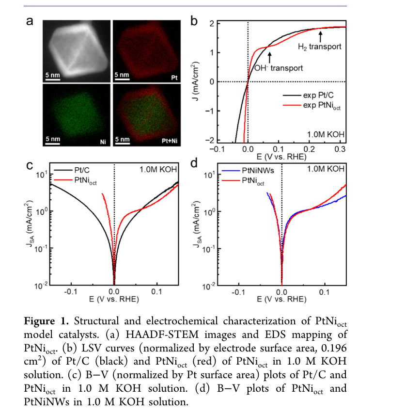
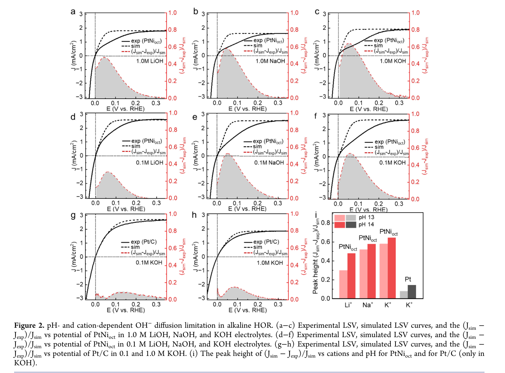
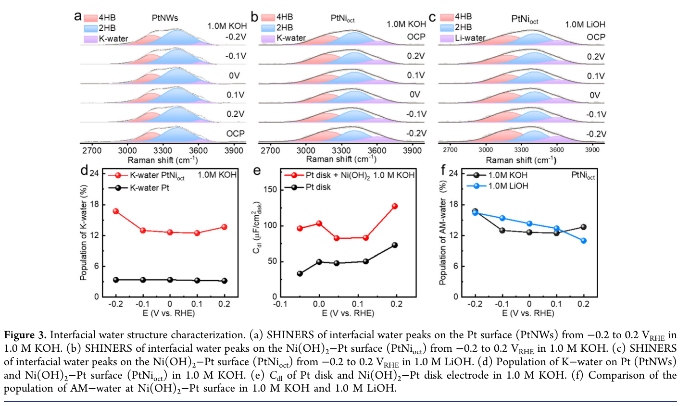
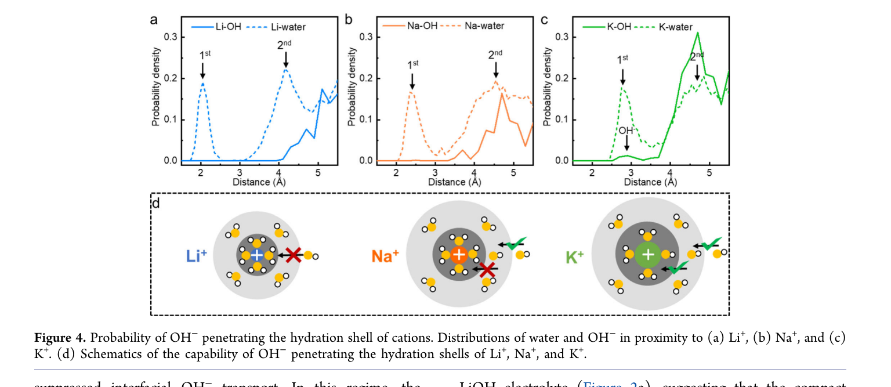
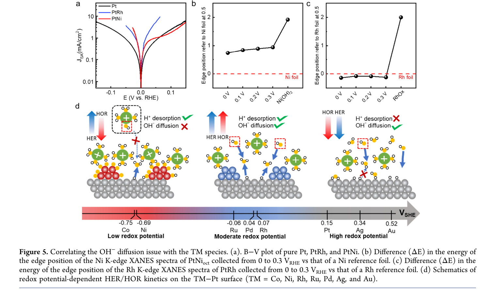

# 精读卡：Cation-Limited Hydroxide Anion Diffusion Drives Asymmetric Hydrogen Kinetics on Transition-Metal Decorated Platinum Surface

> **证据状态**  
> Source coverage: 主文全文（PDF p. 1–9）与补充信息全文（SI PDF p. 1–23）  
> Extraction confidence: High（文字提取完整；自动未识别图表，已人工检查主文 Figure 1–5、SI Figure S1–S12、补充 Note Figure 1 和 Table S1）  
> Locator mode: page-grounded  
> Primary analytical lens: discovery / mechanism  
> Secondary analytical lens: materials  
> Context verification: targeted external check  
> Card completeness: Complete relative to the supplied main article and SI（主文与 SI 均已核读；原文没有给出的信息仍明确标为未报告）

## 术语表

| 统一用语 | 首次释义 | 原文变体 | 本卡用法 |
|---|---|---|---|
| HER | hydrogen evolution reaction，析氢反应 | HER | 统一写 HER |
| HOR | hydrogen oxidation reaction，氢氧化反应 | HOR | 统一写 HOR |
| TM | transition metal，过渡金属 | TM | 统一写 TM |
| AM⁺ | alkali-metal cation，碱金属阳离子 | Li⁺、Na⁺、K⁺ | 总称写 AM⁺，具体离子单独写 |
| EDL | electrical double layer，电双层 | EDL | 统一写 EDL |
| OHP | outer Helmholtz plane，外 Helmholtz 面 | outer Helmholtz plane | 首次写全称，之后写 OHP |
| SHINERS | shell-isolated nanoparticle-enhanced Raman spectroscopy | SHINERS | 保留缩写 |
| AIMD | ab initio molecular dynamics，第一性原理分子动力学 | AIMD | 统一写 AIMD |
| VRHE | 相对于可逆氢电极的电位 | VRHE、V vs RHE | 统一写 VRHE |
| DOHapp | 由平台电流反推的表观 OH⁻ 扩散系数 | apparent DOH | 明确是模型反推值，不称为直接测量的本征扩散系数 |

## 01 基本信息

- **题目：** Cation-Limited Hydroxide Anion Diffusion Drives Asymmetric Hydrogen Kinetics on Transition-Metal Decorated Platinum Surface
- **作者：** Chengzhang Wan、Zisheng Zhang、Zheng Weng、Qiang Sun、Wei-Hsiang Huang、Ershuai Liu、Zhengyue Chen、Yibo Wang、Ao Zhang、Yansong Ling、Min-Hsin Yeh、Anastassia N. Alexandrova、Qingying Jia、Yu Huang、Xiangfeng Duan。
- **期刊：** *Journal of the American Chemical Society*，2026，148(22)，22874–22882；DOI：[10.1021/jacs.6c03810](https://doi.org/10.1021/jacs.6c03810)。出版信息由 ACS 核对。[External: ACS 文章记录](https://pubs.acs.org/doi/10.1021/jacs.6c03810)
- **研究类型：** 碱性 HER/HOR 机制发现；以 PtNi、PtRh 等负载型催化剂作为模型材料。
- **关键词：** 碱性电催化、PtNi、表面羟基、碱金属阳离子、OH⁻ 传输、电双层、HER/HOR 不对称。
- **数据/代码：** 所附主文未提供代码或独立数据仓库信息；图表数据与计算细节需查 SI。
- **与用户研究的关系：** [User] 与此前关注的“油浴合成碳负载金属/碳催化剂”直接相关：该文 PtNioct/C 的 SI 合成路线使用碳黑分散、DMF 中前驱体混合和油浴处理；下文单独标明哪些参数来自 SI，而非所附主文。
- **来源范围：** 用户提供的 9 页主文和 23 页 SI 均已读取；SI 包含材料与实验细节、计算方法、Supplementary Notes 及补充图表。[Paper: 主文 PDF pp. 1–9; SI PDF pp. 1–23]

## 02 一句话概括

[Paper] 在碳负载 PtNi 表面，Ni–OH 促进碱性水解离而提升 HER，却可能通过富集水合碱金属阳离子并滞留 OH⁻，使高碱度下的 HOR 受界面 OH⁻ 内向传输限制，从而打破两支反应的表观动力学对称性。[Paper: PDF p. 1, Abstract; PDF pp. 2–7, Figures 1–5]

## 03 研究问题

1. **具体问题：** 如果碱性 HER 与 HOR 共享 Volmer 步，为什么 Ni(OH)₂ 修饰 Pt 能明显促进 HER，却只在靠近平衡电位的窄区间促进 HOR，随后出现额外电流平台？[Paper: PDF pp. 1–3, Figure 1]
2. **重要性：** 只用 H* 结合能、Volmer 活化或“正逆反应应当对称”的框架，可能遗漏 EDL 中离子迁移给 HOR 增加的限制；这会影响对 Pt 基碱性氢电催化剂的材料筛选和电解液选择。[Paper: PDF pp. 1–2]
3. **作者要检验的解释：** TM–OH 是否会先吸引 AM⁺ 到 OHP，再由水合 AM⁺–OH⁻ 相互作用降低 OH⁻ 到达 Pt 表面的有效通量，从而使 HOR 除表面反应步骤外还受界面传质控制？[Paper: PDF pp. 1–7, Figures 2–5]

## 04 研究背景与发展脉络

| 脉络 | 既有解释/进展 | 本文指出的不足 | 本文的位置 |
|---|---|---|---|
| Pt 上的 pH、氢结合与电位零电荷 | 以 H* 结合能、界面电场和水重组解释 pH 对 HER/HOR 的影响 | 这些框架主要着眼于表面反应和电荷转移，难以单独解释 PtNi 上额外的 HOR 平台 | 把界面 OH⁻ 的方向性传输纳入解释。[Paper-framed; PDF pp. 1–2] |
| 羟基修饰与双功能机制 | Ni–OH 等亲氧物种可帮助碱性水解离、改变界面水结构并加快 Volmer 过程 | 对 HER 的促进并不自动意味着 HOR 同幅提升 | 区分“促进表面步骤”与“阻碍反向所需 OH⁻ 到达”。[Paper-framed; PDF pp. 1–2] |
| 碱金属阳离子与 EDL | 阳离子可改变界面水、表面羟基及电双层结构 | 过去对 Pt 上 cation effect 的解释，不能充分说明 TM 修饰后阳离子与 OH⁻ 的协同传输 | 提出 TM–OH 诱导阳离子富集、再限制 OH⁻ 内扩散的机制。[Paper: PDF pp. 1–7] |

[External] 相关前序工作包括讨论碱金属阳离子与 Pt 表面羟基如何影响碱性 HER 的 *Nature Catalysis* 研究，以及讨论修饰 Pt 上吸附羟基与 HER 动力学的 *Nature Energy* 研究。本文是在这些“表面羟基/阳离子调控”背景上，把重点推进到 HOR 支路和 OH⁻ 的界面内向输运；这不是对完整领域历史的穷尽性综述。[Nature Catalysis 2022](https://www.nature.com/articles/s41929-022-00851-x)；[Nature Energy 2020](https://www.nature.com/articles/s41560-020-00710-8)

## 05 论文提出的核心痛点

| 痛点 | 表现 | 作者给出的解释 | 论文证据 |
|---|---|---|---|
| HER/HOR 的实测分支不对称 | PtNi 的 HER 明显增强；HOR 仅在约 0–0.02 VRHE 有提升，约 0.02–0.1 VRHE 出现额外平台 | HER 生成 OH⁻、HOR 消耗 OH⁻，两个方向的 OH⁻ 通量和电场驱动力不同 | Pt/C 与 PtNi 的 LSV、B–V 对比。[Paper: PDF pp. 2–3, Figure 1] |
| 高碱度反而出现更强 HOR 传输限制 | pH 14 的 PtNi 平台比 pH 13 更明显，不能仅用体相 OH⁻ 浓度梯度解释 | TM–OH 诱导的界面阳离子层对 OH⁻ 形成额外阻碍 | 改变 pH、Li⁺/Na⁺/K⁺及离子浓度；Pt/C 作为对照。[Paper: PDF pp. 3–4, Figure 2] |
| TM–OH 可能兼具促进与抑制作用 | Ni–OH 既促进水解离，也伴随 HOR 受限；Rh 修饰表现更接近两支同步增强 | 过多 TM–OH 可能导致强阳离子富集；适量 TM–OH 可促进界面水重组但不过度阻碍 OH⁻ | SHINERS、Cdl、Ni/Rh XANES 与 TM 对比。[Paper: PDF pp. 4–7, Figures 3、5] |

## 06 核心思想

1. **表层方法：** 对比碳负载 PtNioct、PtNi 纳米线、Ni 修饰多晶 Pt、PtRh 纳米线和 Pt/C，在不同碱金属氢氧化物、浓度与电位下测 HER/HOR，并用原位光谱、XANES、EIS 和 AIMD 补充界面信息。[Paper: PDF pp. 2–7, Figures 1–5]
2. **核心洞见：** 同一个亲氧修饰物种能在两个方向扮演不同角色：它可降低水解离的表面反应障碍，但也可能通过形成阳离子富集层，抑制 HOR 所需 OH⁻ 从溶液侧靠近 Pt。由此，测得的分支不对称并不必然代表正逆反应的基本化学步骤“失去可逆性”，也可能来自方向相关的界面传质边界条件。[Analysis: PDF pp. 2–7]
3. **可迁移认识：** 电催化剂不只改变吸附能和活性位；催化剂表面化学还能重塑 EDL 中离子的分布与通量。需要把“表面反应速率”和“界面离子供给/移除”分别识别。[Analysis: PDF pp. 3–7]

## 07 方法总览

**论证流程：** 模型催化剂与 Pt/C 对照 → LSV/B–V 发现 PtNi HOR 额外平台 → 旋转电极与 Levich 分析区分体相传质和界面异常 → 改变 pH、阳离子种类及浓度检验趋势 → SHINERS/Cdl 检查阳离子富集线索 → AIMD 检查 OH⁻ 进入不同阳离子水合层的概率 → Ni/Rh XANES 和 TM 序列检验 TM–OH 丰度与性能的关联 → 提出统一机制图。[Paper: PDF pp. 2–7, Figures 1–5]

**关键材料制备（PtNioct/C）：** SI 报告先将 18 mg Vulcan XC-72 碳黑分散于 9 mL DMF，超声至少 30 min；另将 9 mg Pt(acac)₂、7.2 mg Ni(acac)₂ 和 85 mg 苯甲酸溶于 1 mL DMF 后加入，再超声 5 min；300 rpm 油浴升至 140 °C 保温 1.5 h，再升至 150 °C 保温 24 h；冷却、离心，以异丙醇/丙酮混合液洗涤至少 3 次并真空干燥；约 20 mg 干燥产物在空气中 200 °C 退火 2 h。[Paper: SI PDF p. 2, Methods, “Synthesis of PtNioct”]

[Analysis] 这是一条“碳黑分散—前驱体共处理—洗涤—空气退火”的路线。SI 还说明碳黑使用前在 Ar 中 400 °C 退火 2 h；XPS 的 Ni 2p 与 STEM/EDS 支持 Pt 表面存在 Ni(OH)₂ 类物种，但不能仅凭配方推定全部 Pt/Ni 前驱体的转化率或最终表面比例。[Paper: SI PDF pp. 2, 10; 主文 PDF p. 2, Figure 1]

**对照材料制备：** PtRh 纳米线先在 oleylamine/1-octadecene 中用 Pt(acac)₂、Rh(acac)₃、W(CO)₆、葡萄糖和 PVP 于 160 °C 反应 8 h，再转移到碳黑/乙醇分散液中负载；TM 修饰 Pt 电极则通过 10 μM 金属盐浸泡 5 min，再在 1.0 M KOH 中进行 20 圈 0.05–1.1 VRHE CV，使吸附金属离子转化为金属或金属氢氧化物。[Paper: SI PDF pp. 2–3]

**电化学与计算设置：** RDE/三电极体系，玻碳圆盘几何面积 0.196 cm²；常规测试以 1 mg 催化剂/mL 乙醇制墨并加 Nafion，Figure 1 使用 20 μL 墨水，Figure 2 使用 10 μL 以减小孔内 H₂/OH⁻扩散影响；LSV 扫描速率 5 mV s⁻¹，CV 为 100 mV s⁻¹。LSV 按圆盘几何面积归一化，B–V 按 Hupd 面积归一化。AIMD 模型是 12.5 Å 立方盒中的 63 个水分子、1 个 OH⁻和 1 个 Li⁺/Na⁺/K⁺，300 K NVT，统计平衡后的 20 ps 轨迹；它不是含 Pt 电极的恒电位 EDL 模型。[Paper: SI PDF pp. 4–5]

**催化剂墨水细节：** SI 的典型配方为 1 mg 干燥催化剂分散于 1 mL 乙醇，超声 5 min 后加入 10 μL 5 wt% Nafion；稳定性测试用 20 μL Nafion。该墨水滴涂在 5 mm 玻碳圆盘上并空气干燥。[Paper: SI PDF p. 4]

## 08 核心模块拆解

| 模块 | 功能 | 为什么需要 | 输入/输出 | 支持证据 | 去掉/改变后的效应 |
|---|---|---|---|---|---|
| PtNioct/C 模型 | 在 Pt(111) 面上引入 Ni(OH)₂ 类表面物种 | 建立 Ni–OH 对 HER/HOR 的可控比较 | Pt、Ni 前驱体和碳黑 → 负载纳米颗粒 | HAADF-STEM、EDS、XPS；图 1a 与 SI Figure S1。[Paper: PDF p. 2, Figure 1] | 未做严格去除 Ni–OH 的成对消融；只能由 Pt/C 和其他结构样品做间接比较。 |
| LSV 与 B–V | 识别电流平台和动力学分支 | 先判断不对称何时出现，再与表面步骤/传质解释对应 | 电位扫描电流 → 几何面积或 Pt 面积归一化曲线 | Pt/C、PtNioct、PtNi 纳米线曲线。[Paper: PDF pp. 2–3, Figure 1] | 改变转速、气体传质或面积归一化可改变表观平台；不能把曲线差异直接等同某一微观步骤。 |
| pH/阳离子扰动和理想曲线比较 | 量化实测 HOR 相对“对称动力学 + H₂ 传质”的偏离 | 测试阳离子种类、浓度和碱度是否与异常 HOR 同步变化 | 0.1/1.0 M LiOH、NaOH、KOH 等 → R = [Jsim − Jexp] / Jsim | K⁺偏离最大，Pt/C 偏离较小。[Paper: PDF pp. 3–4, Figure 2] | 该对比量依赖理想曲线假设；它不是直接测得的 OH⁻ 通量。 |
| SHINERS 与 Cdl | 观察界面水合阳离子信号并测双电层电容 | 为“Ni(OH)₂-Pt 上阳离子富集”提供实验线索 | 电位与电解液 → 水振动峰比例、Cdl | Ni(OH)₂-Pt 的 K⁺-水峰比例约 12–18%，Pt 纳米线约 3%；前者 Cdl 更高。[Paper: PDF p. 4, Figure 3] | Raman 识别的是阳离子水合水信号，不能单独确定 Ni–O–K 结构或 OH⁻ 被困位置。 |
| AIMD 水合层分布 | 比较 OH⁻ 进入 Li⁺、Na⁺、K⁺水合层的倾向 | 给出 K⁺比 Li⁺更容易与 OH⁻形成共享/接触离子对的分子图像 | 水和 OH⁻围绕阳离子的径向分布 → 水合壳层概率 | 图 4 的分布与示意图。[Paper: PDF pp. 5–6, Figure 4] | 没有直接模拟真实电极、恒电位 EDL 中的 OH⁻跨层扩散速率；计算支持可行性，不等于界面机理已被直接拍到。 |
| XANES 与 TM 序列 | 检验不同 TM 氧化状态/表面羟基丰度是否关联 HER/HOR 类型 | 判断 Ni 和 Rh 等是否可形成相同程度的阳离子富集层 | TM 修饰电极 → 氧化态线索、动力学对比 | Ni 在 HOR 电位下呈 0 至 +2 的状态区间，Rh 接近金属态；Ni/Rh 的 HOR 差别见图 5。[Paper: PDF pp. 6–7, Figure 5] | 氧化态不是 OH 覆盖度的直接定量；不同 TM 的负载量、形貌和位点阻塞也可能贡献差异。 |

**消融性质：** 本文不是机器学习式模块消融研究；主要依靠电解液、pH、催化剂和阳离子扰动构成机制对照。未见一个“只改变 Ni–OH、其他界面参数完全不变”的直接消融实验。[Analysis: PDF pp. 2–7]

## 09 关键公式与符号

1. **碱性 Volmer 步：** HER：H₂O + e⁻ + * → H* + OH⁻；HOR：H* + OH⁻ → H₂O + e⁻ + *。其中 * 表示表面位点，H* 为吸附氢。本文强调 HER 生成 OH⁻后向外移除，HOR 则需要 OH⁻向内到达 Pt 附近。[Paper: main PDF pp. 2–3]

2. **Figure 2 偏离指标：** R(E) = [Jsim(E) − Jexp(E)] / Jsim(E)。Jsim 是假设 HER/HOR 在近平衡区对称、并只考虑 H₂ 扩散限制的理想 HOR 曲线；Jexp 是实验曲线。作者把两者差异归因于额外界面 OH⁻扩散限制；因此 R 是依赖模型基线的相对偏离，不是 OH⁻通量或扩散系数的直接测量。[Paper: main PDF p. 4, Figure 2; SI PDF pp. 4–5]

3. **Levich 与表观扩散系数：** SI 使用 Jlim = 0.62 nF D2/3 ν−1/6 ω1/2 C，其中旋转速度、体相浓度、黏度和面积归一化影响反演。Pt 圆盘 pH 11 得到常规 OH⁻扩散系数约 5.4 × 10⁻⁵ cm² s⁻¹；PtNi 在 pH 14 的 DOHapp 按电极面积归一化约 1.48 × 10⁻¹⁰ cm² s⁻¹，按 Pt 面积归一化约 3 × 10⁻¹¹ cm² s⁻¹。作者明确称这是半定量估算，绝对数值依归一化方法而变，但差异仍超过 5 个数量级。[Paper: SI PDF pp. 7–8, Supplementary Note 2; main PDF p. 3]

4. **动力学与传质模型：** SI 用 Ikin = −A exp(−Bη) + A exp(Bη) 拟合近平衡区 HER 的对称 Butler–Volmer 形式，再用 1/I = 1/Ilim + 1/Ikin 计算假设没有 OH⁻界面限制时的 HOR 曲线。作者仅选 HER 的 −0.03 至 0 VRHE 区间拟合；SI 指出 PtNi 的常规 B–V 参数本身不具物理意义，因此该曲线是比较基线，不是对 PtNi 完整 HOR 机理的拟合。[Paper: SI PDF pp. 4–5, Eqs. 1–2; SI PDF pp. 7–8, Supplementary Note 2]

## 10 实验设计与证据链

**样品、条件与指标：** 主文覆盖 Pt/C、PtNioct/C、PtNi 纳米线、Ni 修饰多晶 Pt、PtRh 纳米线，以及 Co、Ni、Rh、Ru、Pd、Ag、Au 修饰 Pt。电化学比较涉及 0.1/1.0 M LiOH、NaOH、KOH，pH 13–14 和转速依赖；LSV 按几何电极面积归一化，B–V 按 Hupd 面积归一化。表征包括 HAADF-STEM/EDS、XPS、SHINERS、EIS/Cdl、XANES 和 AIMD。SI 还报告 SHINERS 光谱每次 10 s、累积 3 次；但所审读的主文与 SI 图注未给出关键电化学曲线的独立重复数和误差区间。[Paper: main PDF pp. 2–7; SI PDF pp. 3–5]

| 实验 | 被检验的主张 | 比较和条件 | 观察结果 | 可支持的结论 | 不能据此断言 | 来源 |
|---|---|---|---|---|---|---|
| PtNi 与 Pt/C 的 HER/HOR | Ni 修饰能否同幅促进两支反应 | 1.0 M KOH；LSV、Pt 面积归一化 B–V | HER 增强；HOR 仅近 0–0.02 VRHE 有提升，随后约 0.02–0.1 VRHE 出现平台 | PtNi 的表观 HER/HOR 动力学不同；异常局限在特定电位区间和条件 | 不能仅从平台断定其唯一原因必然是 OH⁻扩散 | [Paper: PDF pp. 2–3, Figure 1] |
| Pt 体相 OH⁻传质基线与 PtNi 平台 | 额外平台是否可用普通体相 OH⁻扩散解释 | pH 11 Pt 测转速依赖；与 pH 14 PtNi 比较 | Pt 的 DOH ≈ 5.4 × 10⁻⁵ cm² s⁻¹；按 Levich 估算 pH 14 限流约 2.3 A cm⁻²，远高于 H₂ 限流；PtNi 平台约 0.001 A cm⁻²；反演 DOHapp 依归一化为约 1.48 × 10⁻¹⁰ 或 3 × 10⁻¹¹ cm² s⁻¹ | PtNi 有额外界面 OH⁻传输障碍的解释合理 | 作者说明为半定量估算，面积归一化不唯一；不是直接测量的界面扩散常数 | [Paper: main PDF p. 3; SI PDF pp. 7–8, Supplementary Note 2; SI PDF p. 13, Figure S4] |
| 阳离子/碱度扰动 | 异常是否随 AM⁺种类、碱度变化 | 0.1/1.0 M LiOH、NaOH、KOH；另独立改变 Na⁺与 OH⁻浓度 | 1 M 时 R 峰值 KOH 0.64、NaOH 0.58、LiOH 0.48；0.1 M 时约 0.58、0.52、0.30；固定 [Na⁺]=1 M、提高 OH⁻浓度时限制增强 | OH⁻浓度变化是 pH 13→14 影响的重要来源；阳离子趋势以 K⁺最强 | 不能把阳离子半径视为唯一变量，活度、粘度和水结构仍可能共同变化 | [Paper: main PDF pp. 3–4, Figure 2; SI PDF p. 15, Figure S6] |
| SHINERS 和 Cdl | Ni(OH)₂-Pt 是否有更强界面阳离子富集线索 | Pt 纳米线与 PtNi；KOH/LiOH、不同电位 | K⁺水合水峰比例 PtNi 约 12–18%，Pt 约 3%；Ni(OH)₂-Pt Cdl 更高 | 与 Ni(OH)₂-Pt 具有更多界面水合阳离子相一致 | 不直接证明完整的 Ni–OH···K⁺···OH⁻离子对或 OH⁻停留时间 | [Paper: PDF p. 4, Figure 3] |
| 负载量与转速对照 | 限制更像体相对流控制，还是粒子/界面控制 | PtNi 不同负载量、Hupd 面积及 RDE 转速 | OH 限流电流随 Hupd 面积近线性增加；Pt pH 11 的限流随转速平方根变化 | 支持 PtNi 额外限制位于纳米颗粒/Helmholtz 界面附近，而非单纯由体相对流解释 | 仍是间接定位，不能单独分开局部迁移与扩散的贡献 | [Paper: SI PDF p. 7, Supplementary Note Figure 1; SI PDF pp. 12–13, Figures S3–S4] |
| AIMD 水合壳层概率分布 | OH⁻是否更容易进入较大阳离子的水合壳层 | 比较 Li⁺、Na⁺、K⁺周围水/OH⁻分布 | OH⁻排斥于 Li⁺壳层；Na⁺可进入第二层；K⁺进入第二层概率更高，且有第一层小峰 | 阳离子水合壳层差异提供 K⁺更易形成共享/接触离子对的原子尺度可行性 | 计算盒不含 Pt 电极，不能直接证明真实 EDL 中 OH⁻扩散系数下降 | [Paper: main PDF pp. 5–6, Figure 4; SI PDF p. 5, Computational Methods] |
| Ni/Rh 与 TM 系列 | TM 氧化/羟基倾向是否可解释不同 HER/HOR 分区 | PtNi、PtRh；Co、Ni、Ru、Rh、Pd、Ag、Au 的 B–V 与 CV | Ni/Co 低电位组偏 HER 增强、HOR 受抑；Ru/Rh/Pd 两支增强；Ag/Au 略抑两支。Table S1 给出 pH14 氧化还原对电位 | TM–OH 丰度可能同时促进 Volmer 与加重 cation-mediated OH⁻限制 | 电位相关不等于单一因果；覆盖度、形貌、Pt 位点阻塞仍可能贡献 | [Paper: main PDF pp. 6–7, Figure 5; SI PDF pp. 19–22, Figures S10–S12 and Table S1] |

### 主图论证地图

- **Figure 1：现象与基线。** PtNi 的 HER/HOR 不对称和多形貌上的额外 HOR 平台；为问题立项。
- **Figure 2：机制扰动。** 改变阳离子和 pH，比较实验曲线与对称动力学/H₂传质模型；量化额外限制。
- **Figure 3：界面阳离子线索。** SHINERS 的阳离子结合水信号及较高 Cdl，支撑阳离子富集解释。
- **Figure 4：分子图像。** AIMD 显示 OH⁻更容易进入 K⁺而非 Li⁺的水合壳层；解释阳离子趋势。
- **Figure 5：跨金属联系。** Ni/Rh 电化学与 XANES，以及作者的 TM 氧化电位机制示意；扩展到不同 TM。

**SI 证据清单：** Figure S1 为 Ni 2p XPS；S2 为 Ni(OH)₂ 修饰多晶 Pt 的 LSV；S3–S4 为 Pt 与 PtNi 的转速/扩散系数对照；S5 为不同电解液的 B–V；S6 独立改变 Na⁺和 OH⁻浓度；S7 为 PtRh 纳米线 TEM/STEM/EDS；S8 为 Ni/Rh 原位 XANES；S9 为 Pt/Ni-Pt/Rh-Pt 的 Cdl；S10–S11 为 TM 系列 B–V；S12 为 TM 修饰 Pt 的 CV 和 OH 脱附峰；Table S1 为 pH 14 氧化还原电位；Supplementary Note Figure 1 为 PtNi 负载量与 Hupd 面积对 OH 限流电流的关系。[Paper: SI PDF pp. 7, 10–22]

**主文 Figure 1–5 原图（含期刊图注）：**

Table S1 所列电位（VSHE）为 Co −0.75、Ni −0.69、RuO₂/Ru −0.25 或 Ru(OH)₃/Ru −0.06、Rh 0.04、Pd 0.07、Pt 0.15、Ag 0.34、Au 0.52；Ru 对应两种氧化还原对。作者据此把 TM 分为低、中、高氧化还原电位组，但这些标准电位不等于实际工作电位下表面 OH 覆盖度。[Paper: SI PDF p. 22, Table S1]

## 11 正确解读结论

- **结论适用范围：** 文章支持的是特定 Pt–TM 表面、强碱电解液及其所测电位区间内的动力学差异；不能直接推广到所有 Pt 合金、任意 pH 或工业电流密度条件。[Paper: PDF pp. 2–7]
- **“扩散受限”的含义：** 主要是模型分解出的界面 OH⁻传输阻力/表观系数。作者在 SI 明确说明 PtNi 的估算是半定量的，面积归一化会改变 DOHapp 数值；但按两种归一化都比普通水溶液低逾 5 个数量级。[Paper: SI PDF pp. 7–8, Supplementary Note 2]
- **“模拟”的含义：** Figure 2 的 Jsim 是建立在动力学对称与 H₂ 传质假设上的理想伏安曲线；Figure 4 才是 AIMD。两者不要混为一谈。[Paper: PDF pp. 3–6]
- **0.1 V 以上 HOR 电流再次上升：** SI 将其解释为局部 OH⁻降低后，反应从 OH⁻路径转向水路径；作者用 XANES、Raman 与 EIS 认为此段阳离子分布没有明显重排。这个“局部 pH/路径转换”是作者的解释，未见直接测得表面 OH⁻浓度阈值。[Paper: main PDF p. 3; SI PDF p. 6, Supplementary Note 1]
- **HER 支路的阳离子效应：** SI 指出 PtNi 上 HER 对 Li⁺/Na⁺/K⁺身份没有明显依赖；作者解释为已有高覆盖 Ni–OH 促进 Volmer 步，削弱了阳离子大小对 HER 的额外影响，而 HOR 仍对 OH⁻输运敏感。[Paper: SI PDF p. 9, Supplementary Note 3]
- **机制证据强度：** 电化学扰动说明额外限制与 pH、阳离子及 PtNi 修饰相关；SHINERS/Cdl 支持阳离子富集；AIMD 提供水合壳层离子对的合理性。三类证据相互吻合，但仍未直接观测到真实电极 EDL 中 OH⁻跨过阳离子层的轨迹或通量。
- **作者声称的 TM 趋势：** Ni/Co：HER 增强、HOR 受抑；Ru/Rh/Pd：两支均增强；Ag/Au：两支略受抑。SI 的 Figures S10–S12 与 Table S1 已核对，支持这组定性分区；它们仍不足以证明氧化还原电位是唯一决定变量。[Paper: main PDF p. 7; SI PDF pp. 19–22]
- **边界化复述：** 在本文所测的强碱 PtNi 模型体系中，Ni–OH 促进 HER 的同时可能通过阳离子富集与水合层离子对降低 HOR 所需 OH⁻的有效界面输运；这为观察到的额外平台提供了有多种相互支持证据的机制解释，但仍需直接通量测量和更严格的界面结构因果控制。

## 12 作者明确承认的局限

| 作者明确指出的限制 | 具体表现 | 作者如何处理/建议 | 来源 |
|---|---|---|---|
| PtNi 的 OH⁻扩散系数只能半定量估算 | OH⁻限流受体相扩散和界面迁移混合控制，没有唯一合适的 Pt 表面积或电极面积归一化；两种归一化给出约 3 × 10⁻¹¹ 与 1.48 × 10⁻¹⁰ cm² s⁻¹ | 作者强调只能作数量级比较，二者都支持比常规 OH⁻扩散低逾 5 个数量级 | [Paper: SI PDF pp. 7–8, Supplementary Note 2] |
| PtNi 上常规 Butler–Volmer 动力学拟合不可靠 | OH⁻受限平台出现在小 HOR 过电位，且多步骤 PCET、EDL 与 TM 氧化态随电位变化，违背单一电子转移步骤的理想拟合条件 | 不报告交换电流、转移系数或 Tafel 斜率的常规拟合；只用近平衡 HER 支路构建对称参考曲线 | [Paper: SI PDF pp. 4–5, 7–8, Supplementary Note 2] |

作者还指出，Figure 2 的阳离子/界面解释来自多种证据拼合；对不同 EDL 和复杂电解液的应用仍是设计展望，而不是已经验证的结论。[Paper: main PDF p. 7, Conclusion; SI PDF pp. 6–9]

## 13 批判性分析

| [Analysis] 观察 | 潜在问题/替代解释 | 为什么重要 | 如何检验 | 依据 |
|---|---|---|---|---|
| “额外扩散阻力”由理想 HOR 曲线与实验曲线的差值推得 | 理想曲线来自近平衡 HER 支路的对称 B–V 外推，再用 Koutecký–Levich 处理 H₂ 传质；作者自己也指出 PtNi 的完整 B–V 拟合不具物理意义 | Figure 2 的主判据是否特异代表 OH⁻传输，仍依赖参考模型 | 在同一电极上独立测量 OH⁻界面浓度/通量，并对基线参数做敏感性分析 | [Paper: main PDF p. 4, Figure 2; SI PDF pp. 4–5, 7–8] |
| SHINERS 的 K⁺–水峰与较高 Cdl 用来支持阳离子富集 | Cdl 还受粗糙度、有效面积、表面氧化态和孔隙影响；水合水比例也不是绝对 K⁺面密度 | 若阳离子富集没有被独立定量，链条“Ni–OH → cation layer”仍有推断环节 | 以校准的原位 X-ray/振动谱或电位依赖离子敏感探针定量界面阳离子，并做 ECSA/粗糙度匹配 | [Paper: PDF p. 4, Figure 3] |
| AIMD 给出 Li⁺/Na⁺/K⁺周围径向分布 | SI 的模型是 63 个水分子、1 个 OH⁻和 1 个阳离子的小水合体系，没有 Pt 电极、恒电位或显式 EDL；20 ps 统计不足以直接给出真实界面跨层扩散 | “小体系中可形成离子对”与“真实电极上因此限制反应通量”不是同一命题 | 用包含 Pt(111)/Ni–OH、恒电位和显式电解液的长时间 AIMD/增强采样，计算 PMF、驻留时间及扩散张量 | [Paper: main PDF pp. 5–6, Figure 4; SI PDF p. 5, Computational Methods] |
| Li/Na/K 趋势解释为水合层软硬和离子半径差异 | 阳离子身份还会共同改变活度、溶液粘度、导电率、H₂溶解度及界面水结构 | 等摩尔浓度不一定是等 OH⁻活度或完全匹配的传质条件 | 固定 OH⁻活度并测溶液物性；补充同离子强度、同黏度和不同阳离子的交叉对照 | [Paper: PDF pp. 3–5, Figures 2–4] |
| TM 氧化电位与 HER/HOR 三分区相吻合 | TM 覆盖量、粒径/形貌、Pt 台阶位点阻塞、实际 M–OH 覆盖度可能同步变化 | 相关性不等于“氧化电位单独决定机理” | 用相同 Pt 晶面、相同 TM 表面原子分数和原位定量 M–OH 覆盖度做系列实验 | [Paper: main PDF pp. 6–7, Figure 5; SI PDF pp. 19–22, Figures S10–S12 and Table S1] |
| 现有机制证据还没有直接测量界面 OH⁻通量 | LSV 残差、阳离子结合水峰、较高 Cdl 和小水合体系 AIMD 彼此一致，但没有给出真实 Pt–NiOH EDL 中 OH⁻的绝对浓度、驻留时间或跨层通量 | 对因果机制的把握应低于对“PtNi 有额外 HOR 限制”这一现象的把握 | 联合原位界面 OH⁻探测、阳离子定量与同条件微观模拟 | [Paper: main PDF pp. 3–6; SI PDF pp. 5, 7–8] |
| 主文与 SI 没有报告所审读曲线的独立重复数/误差区间和高电流器件耐久性 | SI 说明 Raman 每谱累积 3 次，但这不是独立样品或独立电极重复；所给性能为实验室 RDE 条件 | 不能把机制论文的动力学发现直接写成耐久或工业性能结论 | 在明确的 Pt 质量活性、ECSA、独立重复、稳定性和器件条件下复测 | [Paper: main PDF pp. 2–7; SI PDF pp. 3–5, 10–22] |

## 14 可迁移知识

### Agent-derived knowledge candidates

1. **方向性通量很关键。** HER 需要把生成的 OH⁻从界面移走；HOR 需要把 OH⁻送到 Pt 活性位附近。即使化学反应互为逆反应，两种工作方向的浓度梯度和界面电场不相同，实测动力学就可能受不同传质边界控制。[Analysis: PDF pp. 2–3]
2. **把“表面促进剂”也看成“界面结构调节剂”。** Ni–OH 不只改变 Volmer 反应本身，也可能改变 EDL 中 AM⁺和 OH⁻的空间分布；优化时需要同时关注表面速率与界面离子迁移。[Analysis: PDF pp. 4–7]
3. **不同证据层要各自回答不同问题。** LSV 给宏观动力学现象；SHINERS 给界面振动/水合环境线索；XANES 给平均氧化态变化；AIMD 给原子尺度的可行结构。它们相互吻合并不意味着任何单个手段独自证明完整因果链。[Analysis: PDF pp. 2–7]
4. **“表观扩散系数”需绑定模型。** 由限流平台反推的数值包含电极界面、局部反应和传质模型假设；报告时必须说明测量对象、几何和反演方法，避免把它当作体相材料常数。[Analysis: PDF p. 3]

## 15 与既有知识的联系

- [External] Shah 等人在 *Nature Catalysis* 2022 研究 AM⁺和 Pt 表面羟基对碱性 HER 的作用；本研究共享“阳离子 × 表面羟基”的视角，但扩展问题到 Pt–TM 的 HER/HOR 不对称，并提出 OH⁻内向输运受限这一解释。[Nature Catalysis 2022, 5, 923–933](https://www.nature.com/articles/s41929-022-00851-x)
- [External] McCrum 与 Koper 在 *Nature Energy* 2020 讨论修饰 Pt 上吸附 OH 对 HER 动力学的作用；本文保留了 OH 参与表面反应的框架，同时指出富集的 TM–OH/AM⁺可能给 HOR 添加界面输运瓶颈。[Nature Energy 2020, 5, 891–899](https://www.nature.com/articles/s41560-020-00710-8)
- [Analysis] 因而这篇文章适合放在一条“吸附能/Volmer → 界面水和阳离子 → OH⁻输运”机制线索上读：新意主要在把**方向相关的阴离子传输**提升为解释 HER/HOR 分支差异的候选控制因素，而非只增加一个新的催化剂配方。
- [User] 与用户先前关注的油浴法碳负载催化剂相关：本文 SI 给了可复现的 PtNioct/C 油浴配方；但这篇文章的科学主张是界面反应机制，不能从一篇配方推导“油浴法普遍适用”或“负载率/分散度必然优越”。[Paper: SI PDF p. 2]

## 16 研究假设与候选方向

### Agent-derived research candidates

#### 候选 1：直接测量 PtNi 界面 OH⁻通量

- **来源观察：** Figure 2 用伏安曲线模型残差识别 OH⁻限制，但 Figure 3/4 主要间接支持阳离子富集和水合离子对。[Paper: main PDF pp. 3–6, Figures 2–4; SI PDF pp. 5, 7–8]
- **假设：** 在相同 OH⁻活度下，PtNi 表面附近 OH⁻的有效到达通量低于 Pt/C；KOH 中抑制强于 LiOH，且在约 0.05 VRHE 最明显。
- **相对本文的变化：** 从“性能残差 + 水合层概率”转为直接或准直接的界面浓度/通量读出；同步匹配溶液粘度、离子强度和电极 ECSA。
- **验证计划（validation）：** 用可校准的原位振动光谱/界面 pH 探针，配合 RDE 与 PtNi/Pt/Rh–Pt 对照；记录电位依赖 OH 信号和 HOR 动力学电流，检验其是否与 R(E) 同步变化。
- **可证伪结果：** 若界面 OH⁻信号/通量在 PtNi 与 Pt/C 间无可重复差异，或差异不随 K⁺/Li⁺变化，而 HOR 平台仍存在，则本文所提传输链条需要修正。
- **失败模式（failure modes）：** 光谱信号可能无法区分 OH⁻与表面 OH*；局部 pH 探针可能扰动纳米 EDL；不同表面粗糙度也可能改变信号强度。
- **创新性状态（innovation status）：** unverified；需要 prior-art search。

#### 候选 2：在保留 HER 促进作用时调节阳离子滞留

- **来源观察：** PtNi 的 Ni–OH 同时与 HER 增强和 HOR 传输限制相关，尚缺少仅改变界面阳离子层、尽量不改变 Pt 活性位的干预。[Paper: PDF pp. 2–7]
- **假设：** 如果降低 OHP 中 AM⁺驻留/AM⁺–OH⁻配对，而维持相近 Ni–OH 覆盖度，PtNi 的 HOR 平台会减弱，同时 HER 的水解离促进大体保留。
- **相对本文的变化：** 把“换 TM/换电解液”进一步拆成一个可调的界面层变量，并把 Ni–OH 覆盖度与阳离子富集分别定量。
- **验证计划（validation）：** 制备同粒径、同 Pt ECSA、相近 Ni 表面覆盖度的 PtNi/C；用受控退火或表面配体/电解液配方小范围调节 OHP，再测 SHINERS、Cdl、XANES 和 HOR/HER。主要比较 HOR 动力学区 jk、平台强度与 HER 电流。
- **可证伪结果：** 若阳离子相关信号明显下降但 HOR 平台不变，或 HER 也同步大幅变差而无法分离两种作用，则“阳离子层可独立调节”的设想不成立或缺少选择性。
- **失败模式（failure modes）：** 退火/配体也会改变 Ni 氧化态和 Pt 位点可及性；电解液添加物可能直接吸附并毒化 Pt；ECSA 匹配不等于原子级位点匹配。
- **创新性状态（innovation status）：** unverified；需要 prior-art search。
